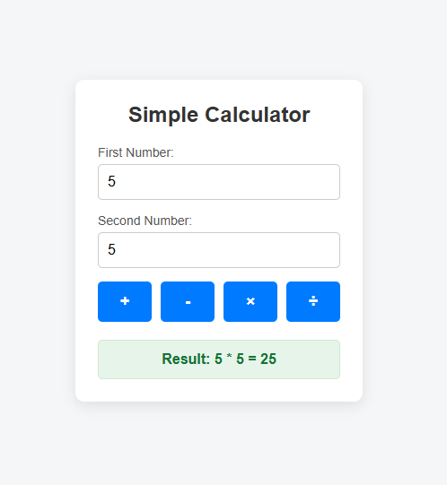

# Simple Calculator Project

## Project Description
A simple, interactive web-based calculator application that performs basic arithmetic operations with input validation. It features a responsive and modern user interface, real-time keyboard navigation support, and intelligent error handling to ensure seamless user interaction and calculations.
## Technologies Used
- HTML5
- CSS3
- JavaScript 

## How to Run
1. Clone or download this repository.
2. Open `index.html` in any web browser.

## Screenshot
